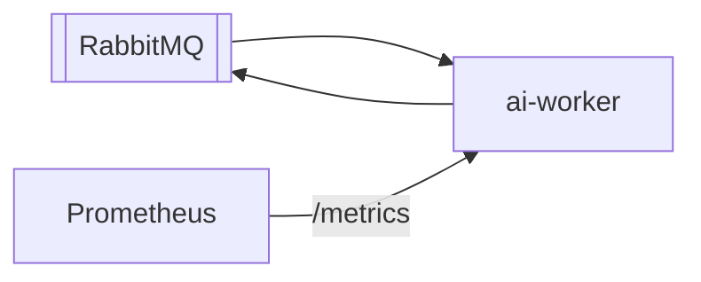

# ai-worker

NestJS worker that consumes comparison jobs from RabbitMQ and produces mock/AI analysis results.

## Ports

- HTTP health: `3001` → `GET /health`
- Prometheus: `GET /metrics`
- gRPC health (optional): `50051` (`contracts/grpc/.../worker_health.proto`)

