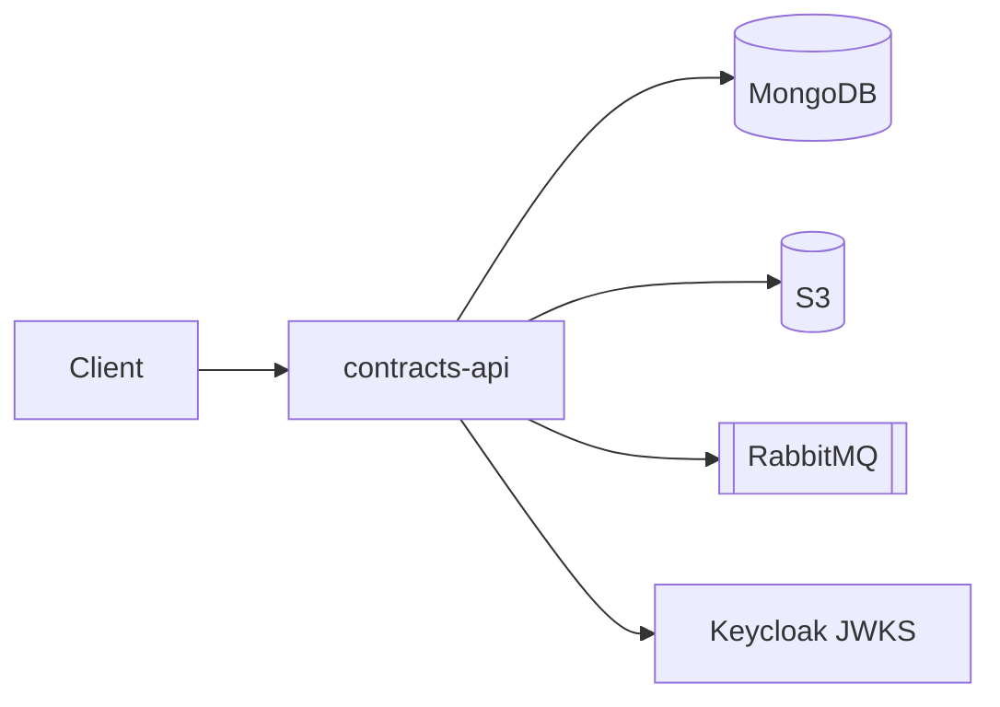

# contracts-api

NestJS **12** + **Express** HTTP API for ContractFlow AI. Hexagonal layout: domain → application → infrastructure.

## Responsibilities

- CRUD for service contracts
- Document upload metadata + S3 storage
- Comparison job creation (publishes to RabbitMQ)
- Job/report queries and PDF download
- OIDC JWT validation (Keycloak) or `AUTH_MODE=dev` headers

## OpenAPI

Swagger UI: `http://localhost:3000/docs`  
JSON: `http://localhost:3000/docs-json`

Export into the monorepo contracts folder (API must be running):

```bash
pnpm openapi:export
# → contracts/openapi/openapi.yaml
```



## Health & metrics

- `GET /health` — Terminus liveness
- `GET /health/ready` — readiness + gRPC ping to `ai-worker` (`WorkerHealth.Check`)
- `GET /metrics` — Prometheus (`prom-client` via `@contractflow/observability`)

## gRPC

Sync channel to workers (async stays on RabbitMQ). Proto: `contracts/grpc/contractflow/v1/worker_health.proto`.
