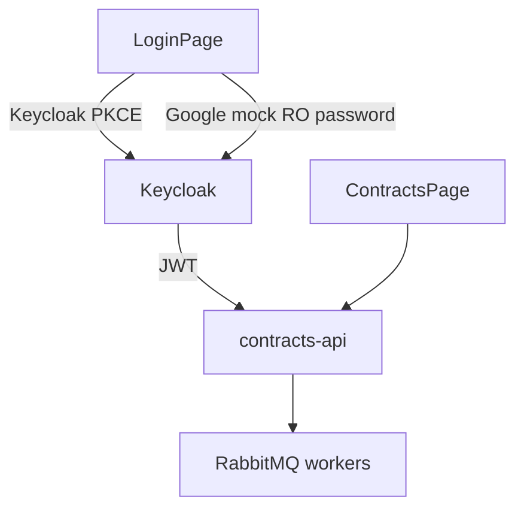

# web-demo

React + Vite SPA for ContractFlow AI. Modular layout (Angular-like feature modules), Tailwind CSS, and Preline UI.

## Stack

- React 19 + React Router
- Tailwind CSS v4 + Preline UI
- OIDC via Keycloak (`oidc-client-ts`) + **Google login mock** (password grant against demo user)
- Multi-file **drag-and-drop** uploads (`FileDropzone`): PDF, Excel, CSV, Markdown, TXT, DOCX

## Module layout

```text
src/
  app/                 # shell, router, Preline init
  core/
    auth/              # AuthProvider, auth.service
    api/               # contracts.api (HTTP)
  modules/
    auth/              # LoginPage
    contracts/         # workspace UI + hooks + components
  shared/ui/           # Button, Alert, Badge, Spinner
```



## Local development

```bash
# from monorepo root (API must be reachable on :3000)
pnpm --filter @contractflow/web-demo dev
```

Open `http://localhost:5173`. Prefer the same host you register with Keycloak (`localhost`, not mixed with `127.0.0.1`).

## Docker

Served by Nginx on host port **8088**, proxying `/api` to `contracts-api`.

```bash
pnpm stack:up
# http://localhost:8088
```

## Auth notes

- Redirect URIs are derived from `window.location.origin` at runtime.
- Access tokens are silent-renewed before API calls.
- **Continue with Google (mock)** obtains a real Keycloak token for `demo`/`demo` after a fake consent delay. Real Google IdP broker comes later.
