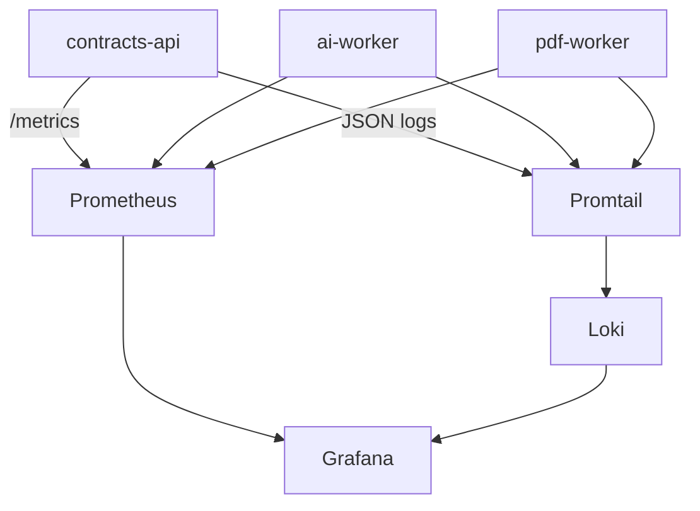

# Observability

## Stack (optional Compose overlay)

```bash
pnpm stack:up
pnpm obs:up   # Prometheus + Grafana + Loki + Promtail
```

| Component | URL |
| --------- | --- |
| Prometheus | http://localhost:9090 |
| Grafana | http://localhost:3003 (admin/admin from `.env`) |
| Loki | http://localhost:3100 |

## Per-service signals

- `GET /health` — liveness + **build identity** (`version.gitSha`, `version.buildTime`)
- `GET /health/ready` — readiness with dependency probes:
  - **contracts-api**: Mongo ping, RabbitMQ exchange check, optional ai-worker gRPC health
  - **ai-worker**: Mongo ping + Rabbit consumer ready
  - **pdf-worker**: Rabbit consumer ready
- `GET /metrics` — Prometheus text via `@contractflow/observability` (`prom-client`)
- **JSON stdout logs** — Nest apps use `JsonLogger`; Promtail scrapes Docker logs → Loki



## Build identity (git SHA)

On `pnpm stack:up` / `obs:up`, Compose injects:

- build-args `GIT_SHA` / `BUILD_TIME` → OCI labels + image env
- runtime env `APP_GIT_SHA`, `APP_BUILD_TIME`, `APP_SERVICE_NAME`

Inspect:

```bash
curl -s http://127.0.0.1:3000/health | jq .version
docker inspect contractflow-contracts-api --format '{{ index .Config.Labels "com.contractflow.git_sha" }}'
```

Container **names** stay stable (`contractflow-contracts-api`); the SHA lives in labels / health, not in the name.

## Logs in Grafana

1. Open Grafana → Explore → datasource **Loki**
2. Query examples:
   - `{service="contracts-api"}`
   - `{service=~"contracts-api|ai-worker|pdf-worker"} |= "error"`

## Notes

- Grafana needs free space in the Docker Desktop VM disk; if it restarts with “database or disk is full”, prune images/build cache or enlarge the Docker disk.
- Loki/Promtail are capped (`mem_limit`) for ~2 GB Docker Desktop; stop with `pnpm obs:down` when not needed.
- If Loki logs `no space left on device`, prune Docker disk (`docker builder prune` / unused images) — the Desktop VM disk fills quickly with builds + Loki chunks.
- Coolify / Tempo / alerts are out of scope for the local MVP.
