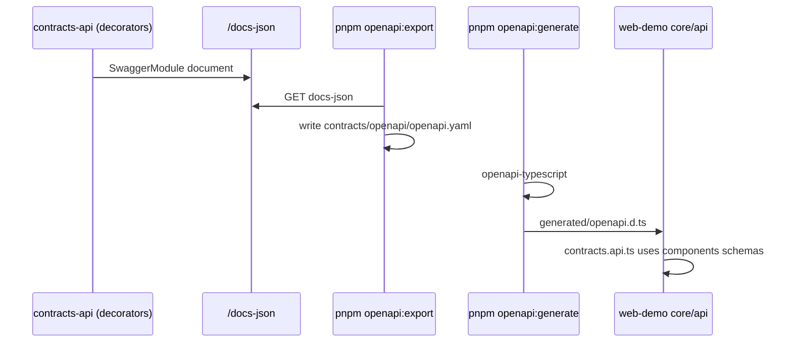

# OpenAPI → front codegen

## Flow



## Commands

```bash
# API must be running (Docker or host)
pnpm openapi:sync
```

| Script | Output |
| ------ | ------ |
| `openapi:export` | `contracts/openapi/openapi.yaml` + `.json` |
| `openapi:generate` | `apps/web-demo/src/core/api/generated/openapi.d.ts` |
| `openapi:sync` | both |

Swagger UI: http://localhost:3000/docs

Keep DTOs annotated with `@ApiProperty` / `@ApiOkResponse` so the exported contract stays truthful.
