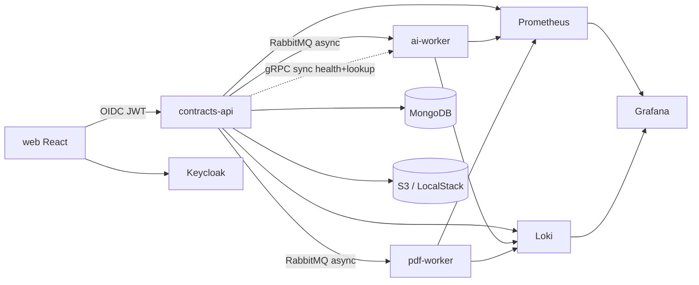

# Next improvements

## Done (2026-11-01 wave)

- OIDC redirect/token fixes; Nest 12 + Express
- React + Tailwind + Preline web demo + Google mock
- OpenAPI decorators → `pnpm openapi:sync` → front `openapi.d.ts`
- Prometheus + Grafana (`pnpm obs:up`) scraping all micros
- gRPC `WorkerHealth` on ai-worker; API `/health/ready`
- Per-app READMEs (api / ai-worker / pdf-worker / web-demo)
- Stable `container_name` (no Compose `-1` suffix); documented in `infra/README.md`
- Git SHA / build time on images + `/health` `version`
- Deeper readiness: Mongo + Rabbit (+ gRPC) probes
- Domain gRPC `ComparisonLookup.GetByJobId` + `GET /api/v1/jobs/:id/worker-comparison`
- Structured JSON logs → Promtail → Loki (Grafana Explore)

## Remaining

| Item | Notes |
| ---- | ----- |
| Coolify | Optional self-host later (deferred) |
| Tempo / traces | Optional distributed tracing |
| Alerts | e.g. `contractflow_process_up == 0` |
| Real LLM provider | Keep `LLM_PROVIDER=mock` until keys are intentional |

