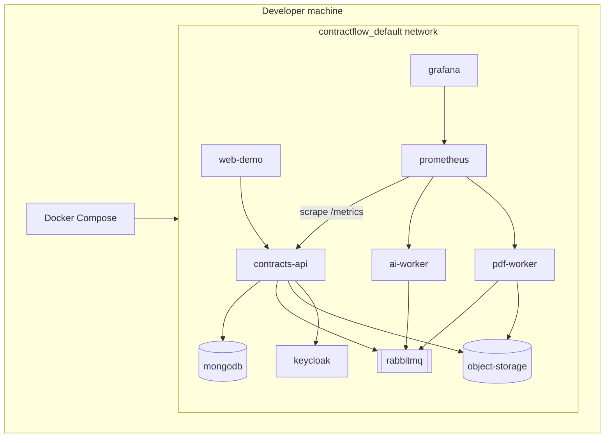

# Infrastructure (local)

ContractFlow AI runs **locally with Docker Compose**, not Kubernetes.

## Docker Compose vs Kubernetes

| | **Docker Compose** (what we use) | **Kubernetes (k8s)** |
| --- | --- | --- |
| Purpose | Define and run a **multi-container app on one machine** | Orchestrate containers across a **cluster** |
| Config | YAML (`compose.yaml`) + overlays | Deployments, Services, Ingress, Helm… |
| Scope | Dev / demo / single-host | Production multi-node |
| Features | Networks, volumes, healthchecks, `depends_on` | Scheduling, rolling updates, autoscaling, self-heal |
| Coolify | Optional later (UI over Docker/Compose/Traefik) | Different world (cluster ops) |

**Compose ≈ “docker run for many services with one network”.**  
**Kubernetes ≈ “production control plane for many hosts”.**

We are **not** using k8s in this repo. Compose is enough for the portfolio MVP and local E2E.



## Compose files (overlays)

| File | Role |
| ---- | ---- |
| `compose.yaml` | **Infra only**: MongoDB, RabbitMQ, LocalStack S3, Keycloak |
| `compose.typescript.yaml` | **Apps**: contracts-api, ai-worker, pdf-worker, web-demo |
| `compose.observability.yaml` | **Optional**: Prometheus + Grafana + Loki + Promtail |

Compose merges files left → right. Same project name → one shared Docker network.

## Project name, service name, container name

Three different names — do not confuse them:

| Concept | Where | Example | Used for |
| ------- | ----- | ------- | -------- |
| **Project** | top-level `name:` in Compose | `contractflow` | Stack group in Docker Desktop, volume/network prefixes |
| **Service** | key under `services:` | `mongodb`, `contracts-api` | DNS inside the Compose network (`mongodb:27017`), `depends_on` |
| **Container** | `container_name:` | `contractflow-mongodb` | What you see in `docker ps` / Docker Desktop |

Without `container_name`, Compose auto-names containers as `{project}-{service}-{replica}` → e.g. `contractflow-mongodb-1`. The trailing `-1` is the replica index, not something we chose.

We set explicit `container_name: contractflow-<service>` on every service so Desktop shows stable names without `-1`.

**Important:** apps still talk to each other by **service** name (`http://keycloak:8080`, `mongodb://mongodb:27017`), not by `container_name`. Changing `container_name` does not break inter-service DNS.

**Trade-off:** fixed `container_name` prevents `docker compose up --scale service=N` for that service (name collision). Fine for this single-host demo; do not scale these services.

| Service key | `container_name` |
| ----------- | ---------------- |
| mongodb | `contractflow-mongodb` |
| rabbitmq | `contractflow-rabbitmq` |
| object-storage | `contractflow-object-storage` |
| object-storage-init | `contractflow-object-storage-init` |
| keycloak | `contractflow-keycloak` |
| contracts-api | `contractflow-contracts-api` |
| ai-worker | `contractflow-ai-worker` |
| pdf-worker | `contractflow-pdf-worker` |
| web-demo | `contractflow-web-demo` |
| prometheus | `contractflow-prometheus` |
| grafana | `contractflow-grafana` |
| loki | `contractflow-loki` |
| promtail | `contractflow-promtail` |

`object-storage-init` is a one-shot job (`restart: "no"`). It exits `0` after creating S3 buckets — that is expected, not a crash.

## Commands (from repo root)

```bash
cp .env.example .env

# Infra only
pnpm infra:up          # docker compose -f infra/compose.yaml up -d

# Full TS stack (infra + apps)
pnpm stack:up          # + compose.typescript.yaml --build
pnpm stack:logs
pnpm stack:down

# Observability overlay (Prometheus :9090, Grafana :3003, Loki :3100)
pnpm obs:up
pnpm obs:down
```

`stack:up` / `obs:up` export `GIT_SHA` (short commit) and `BUILD_TIME` into image labels and `/health` → `version`.

Equivalent raw Compose:

```bash
GIT_SHA=$(git rev-parse --short HEAD) BUILD_TIME=$(date -u +%Y-%m-%dT%H:%M:%SZ) \
  docker compose -f infra/compose.yaml -f infra/compose.typescript.yaml up -d --build
GIT_SHA=$(git rev-parse --short HEAD) BUILD_TIME=$(date -u +%Y-%m-%dT%H:%M:%SZ) \
  docker compose -f infra/compose.yaml -f infra/compose.typescript.yaml -f infra/compose.observability.yaml up -d
```

## Host ports

| Service | URL / port |
| ------- | ---------- |
| Web demo | http://localhost:8088 |
| Contracts API | http://localhost:3000 · `/docs` · `/metrics` · `/health` |
| AI worker | http://localhost:3001 · gRPC `:50051` |
| PDF worker | http://localhost:3002 |
| Keycloak | http://localhost:8080 |
| RabbitMQ UI | http://localhost:15672 |
| LocalStack S3 | http://localhost:4566 |
| MongoDB | localhost:27017 |
| Prometheus | http://localhost:9090 |
| Grafana | http://localhost:3003 (`admin` / `admin`) |
| Loki | http://localhost:3100 |

Credentials for local demo live in **gitignored** `.env` (copy from `.env.example`). Compose app services load `env_file: ../.env` — do not hardcode passwords in YAML. Keycloak realm JSON holds local demo user/client fixtures only (`infra/keycloak/README.md`). No CI/CD pipelines yet — local Compose only.

## Related folders

| Path | Contents |
| ---- | -------- |
| `infra/docker/` | Dockerfiles (`Dockerfile.app`, `Dockerfile.web`) |
| `infra/keycloak/` | Realm import JSON |
| `infra/rabbitmq/` | Broker definitions + conf |
| `infra/observability/` | Prometheus scrape config + Grafana provisioning |
| `docs/architecture/observability.md` | Metrics / health / gRPC probe notes |

## CPU / memory limits

Two layers:

1. **Docker Desktop → Settings → Resources** — global ceiling for the VM (e.g. 2 CPUs / ~2 GB). That is the “Docker” knob.
2. **Compose `cpus` / `mem_limit`** — per-container caps so Keycloak/Mongo cannot alone saturate that ceiling (`docker compose up` honours these).

Tuned for Docker Desktop ≈ **2 CPUs / ~2 GB**:

| Service | CPU limit | Memory limit |
| ------- | --------- | ------------ |
| keycloak | 0.40 | 640M (heap ~384M) |
| mongodb | 0.35 | 384M (`mongo:7` standalone; Atlas Local was unstable at 2 GB) |
| rabbitmq | 0.20 | 192M |
| object-storage | 0.15 | 192M |
| contracts-api | 0.30 | 256M |
| ai-worker | 0.20 | 160M |
| pdf-worker | 0.20 | 160M |
| web-demo | 0.10 | 32M |
| prometheus | 0.10 | 128M |
| grafana | 0.10 | 128M |
| loki | 0.15 | 192M |
| promtail | 0.10 | 64M |

Apply after changing Compose files:

```bash
pnpm obs:up   # or stack:up — recreates containers with new limits
```

Limits are **maxima**, not a guarantee that total usage stays under 2 CPUs (containers can run in parallel). They stop any single service from pegging 100% of a core forever. If the machine still feels heavy, raise Desktop CPUs or stop unused services (`docker stop contractflow-keycloak` when not testing auth).

## What Compose is *not*

- Not a replacement for **Coolify** (self-host control panel) — optional later.
- Not **Kubernetes** — no pods, no cluster, no kubectl required for this project.
- Not production HA — single Docker Desktop / Engine host.
